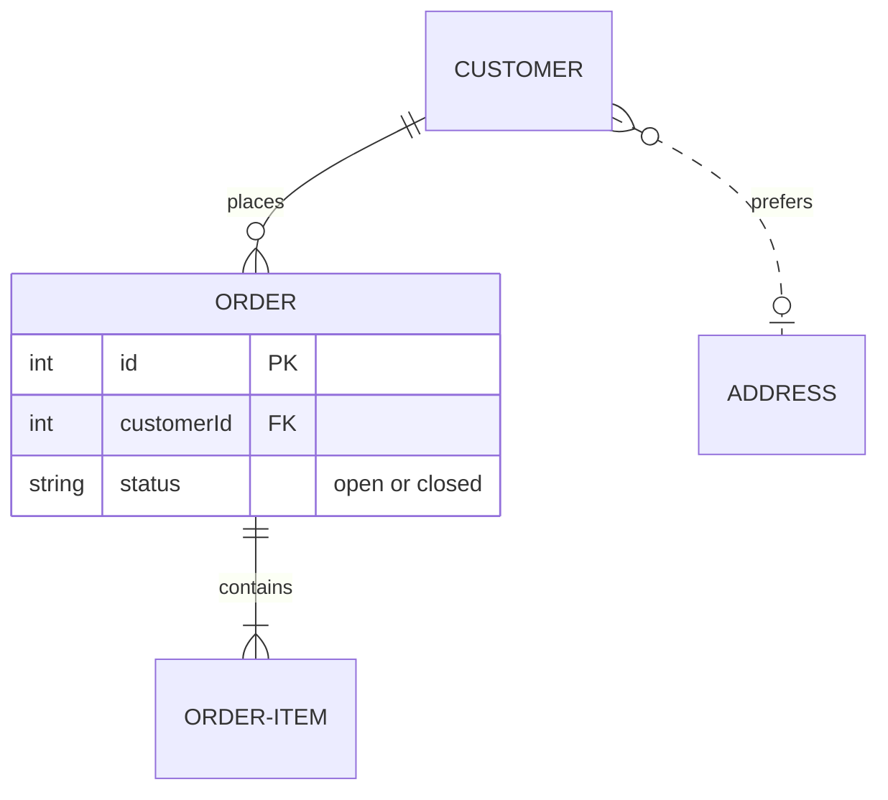
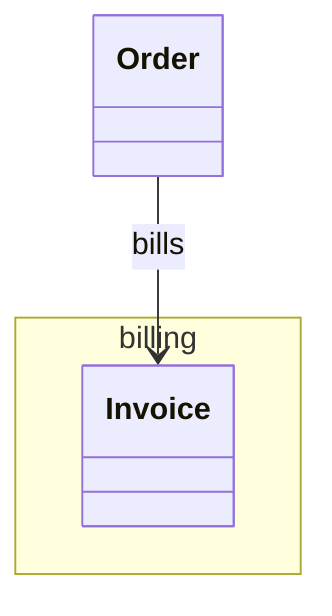

# tam-diagrams

Lays out and draws [SAP TAM](https://www.fmc-modeling.org/download/fmc-and-tam/SAP-TAM_Standard.pdf)
block diagrams and the UML class, use case, activity, state machine and sequence diagrams and the
entity relationship diagrams of [Mermaid](https://mermaid.js.org) as standalone SVG, all in one style. Layout uses
[elkjs](https://github.com/kieler/elkjs), the only dependency.

| Diagram                                    | Source                                                                 |
| ------------------------------------------ | ---------------------------------------------------------------------- |
| TAM block (component) and package diagrams | the `tam` syntax (agents, storages, channels, accesses)                |
| Class diagram                              | Mermaid `classDiagram`                                                 |
| Use case diagram                           | Mermaid `usecase-beta`                                                 |
| Activity diagram                           | Mermaid `flowchart` / `graph`; `swimlane-beta` with one lane per agent |
| State machine diagram                      | Mermaid `stateDiagram-v2`                                              |
| Sequence diagram                           | Mermaid `sequenceDiagram`                                              |
| Entity relationship diagram                | Mermaid `erDiagram`, in crow's foot notation                           |

## Use

```ts
import { renderTam, renderUml, detectUml, svgUrl } from "tam-diagrams";

const colors = {
  background: "#ffffff",
  text: "#1b1c1f",
  secondary: "#3f4146",
  series: ["#2a78d6", "#eb6834", "#1baf7a", "#eda100", "#e87ba4", "#008300", "#6250d6", "#e34948"],
  font: "system-ui",
  dark: false,
};

const { svg, width, height } = await renderTam(
  "agent api[API]\nstorage db[Orders]\napi -- reads/writes --> db",
  colors,
);
if (detectUml(source)) ({ svg } = await renderUml(source, colors));
img.src = svgUrl(svg);
```

- **Errors.** Invalid sources throw `TamError` or `UmlError` with the line. A `UmlError` marked
  `unsupported` means valid Mermaid this package does not draw (pie, gantt, ...): hand those to Mermaid.js.
  `renderUml` and `renderTam` (and the parsers) both raise it for a source that starts with such a type.
- **Class diagrams to explore.** `renderClassView(source, colors, view)` draws a class diagram with
  some packages collapsed into folders and some classes without members; with `view` null it uses
  `overview(diagram)`, which folds a large diagram to its packages and class names. On the result,
  `classPartAt(picture.diagram, picture.view, picture.scene, point)` names the class or package at a
  point, `toggleClassPart(view, part)` opens or closes it, and `classPartBox(scene, part)` says
  where it is drawn now.
- **More diagram types.** The building blocks of the layouts (ELK graph layout, wire and label
  placement, the scene model, layout checks, the best-of-several-strategies search, Mermaid source
  preparation) are exported from `tam-diagrams/layout`.
- **Workers.** Each diagram is laid out several ways and the best layout is kept. By default ELK runs
  in-process. In a browser, pass `{ layout: await elkWorkerPool(url) }` to run the layouts in parallel
  web workers; `url` is where elkjs's `lib/elk-worker.min.js` is served (with Vite:
  `import url from "elkjs/lib/elk-worker.min.js?url"`).
- **Caching.** Layouts are cached by source and font, so a theme change only redraws.
- **Rounded connectors.** With `rounded: true` in the colors, connections bend round at their
  corners, as draw.io draws them; without it their corners are square. `exportDrawio` takes the same
  `rounded` option.
- **Showing the result.** `svgUrl(svg)` gives a `data:` URL for an ``; never insert the SVG into
  the page.
- **Text metrics.** Rendering measures text with a canvas. Without one (Node), pass
  `{ measure }` to `renderTam`, `renderUml` or `renderClassView`: `arialMeasure` is a ready measure
  for Node, or run under jsdom as the tests do.

The package ships TypeScript sources: use it with a bundler or runtime that compiles TypeScript
(Vite, esbuild, Bun, Deno). Node with type stripping (tested on Node 24) runs them from a source
checkout, but does not strip types in files under `node_modules`, so a project that installs the
package needs one of the others, or the command line, which runs from the bundled `dist/cli.js`.

## Editor

`npm run editor` serves a diagram editor (`npm run build:editor` writes it as a static page to
`dist/editor`). It edits every diagram type on a canvas: TAM block diagrams with elements placed by
hand, and the UML types (class, use case, activity with lanes or without, state machine, sequence,
entity relationship)
by their structure, with the layout automatic until a part is moved.
A first visit shows a sample block diagram and a note that says what to try. *File ▸ New* opens a
chooser with a card for each type, and below the cards what to start from (an empty diagram, a
recent one, an example) beside a picture of it; the chip beside the title says which type is on show.

Block diagrams are plain block diagrams: the editor offers agents, human agents, storages and
groups, with channels, accesses and the dependencies between them. A source of the design level
(components, subsystems, classes, packages, interfaces, delegation) still opens, draws and is edited
as text, and keeps the choices it already uses; the palette, the Properties and the completion
offer no more of it. In a block diagram, shapes are dragged from the Shapes tab onto the canvas,
moved, resized, nested by dropping them into a container, and connected by dragging from the dots
beside an element; the Properties section offers only the kinds and connections the notation
allows there. The Connections group of the Shapes tab holds the connections of the notation:
request, data flow and bidirectional channels, the channel without a direction, and read, write
and read/write accesses. A click picks one as the tool: a drag from one element to another, or
from the dots, draws it, and a second click goes back to the connection that fits the two
elements. A pair the connection does not fit (a read access from a storage) is refused with the
rule it breaks. The Outline tab lists the elements as a tree and takes drops too. Copy, cut,
paste, duplicate, undo and redo work as usual. A moved element lines up with the edges and middles of others and with the gaps between them.
A selection is aligned, distributed, made one size, put in a box or laid out on its own from the
Arrange menu, the Properties section or a right click, which also changes what a connection is.

A UML diagram lays itself out until a part is moved; its structure is edited on the canvas. The Shapes tab holds the
pieces of the type (classes and packages, actors and use cases, steps and decisions, states,
participants, entities) and its kinds of connection. A click on a piece adds it at the selected part, a drag
carries it onto a part or the empty canvas; a piece dropped on a group stands inside it, one dropped
on a part is joined to it where the type has such a join (a step follows a step). A drag from the
dots beside a part connects it to another with the kind of connection picked in the palette; a
selected connection changes its kind there or in the Properties section. A double click names a
part or labels a connection; Delete removes what is selected with its connections. A class lists its
members in the Properties section; an entity lists its attributes there, and a relationship says how
many of each entity it joins (exactly one, zero or one, one or more, zero or more) and whether it
identifies. An activity diagram is one type with lanes or without: the first lane added turns its
`flowchart` header into `swimlane-beta`, removing the last lane turns it back, and lanes and groups
do not mix, so the piece that does not fit is off with the reason.

The source pane colors every type's syntax and completes it in context: statements and ids at the
start of a line, the relations a part can start, the parts a relation can reach, members inside a
class, types and keys inside an entity, the branches of a fragment. In a block diagram the list
opens as the line is typed, at every place of it: the kinds, `title`, `direction` and the ids of
the elements at its start; the connections an element's kind can start after its id; the
elements a connection may reach after the arrow, with their names, its own parts, its containers
and elements of the wrong kind left out and those beside it first; the colors after `:::`; and
behind a declaration, once a space follows it or on Ctrl+Space, a color, `{` for a kind that holds
others, `stack` or `...`, and the connections from the new element on the next line. Elements
are offered as the text declares them, before the picture shows them.

*Help ▸ … guide* (F1, or the question mark above the source) opens the guide of the diagram type
beside the source: its rules, every statement the parser reads, an example, and what is refused,
with a filter and a click that writes a row into the source. The same guides are the pages under
[docs/guides](docs/guides); `UPDATE_GUIDES=1 npx vitest run test/editor-reference.test.ts` writes
them anew from `editor/reference.ts`.

The window has a menu bar (File, Edit, View, Arrange, Help) with the document's title, a rail with
the pointer tools, a left panel (Shapes and Outline), a right panel (Properties above Source, with a
splitter between) and a status bar with a hint, the problems of the source, the selection, the
layout mode, snapping and the zoom. The panels are resized by their inner edges and lie over the
canvas in a small window. Alt or F10 puts the keyboard on the menu bar, a letter goes to the row
that starts with it, and Ctrl+K lists every command of the menus to pick one by typing. A source
with an error keeps the last valid picture on show, dimmed, under a banner that leads to the line.
Replacing the diagram (new, open, a recent one, an example) is a step Undo takes back with the view
fitted again, and asks first when there are unsaved changes, with the offer to save them.

*File ▸ Open* takes a `.tam` or `.mmd` source, or a Markdown text, of which it opens the first
`tam` or `mermaid` fence; a file without a diagram is refused and the diagram on show stays.
*Save* writes a block diagram as `.tam` and a Mermaid type as `.mmd`, named after the file it was
opened from or after its title, in whatever script that is written. Where the browser has file
pickers (Chromium), Save writes back to the opened file and *Save as* picks another; elsewhere
both download. *Export* opens a dialog with a preview: SVG or PNG, the PNG at one to three pixels
per unit, on white, on nothing, or in the colors of the editor's theme. A picture is exported in
the light colors unless the theme is asked for, so one made in the dark theme reads on a white page.

*View ▸ Rounded connectors* bends connections round at their corners, in the picture and in what
is exported; the choice is remembered. *Export ▸ Export draw.io* downloads the diagram as a
`.drawio` file, and *File ▸ Open* takes a
draw.io file (`.drawio`, `.drawio.svg`) as well: see [draw.io](#drawio). Saving a diagram opened
from draw.io writes its source beside the file, never over it.

The document is the TAM source, shown beside the canvas and editable there: every gesture is an edit
of that text, and every other line stays as its author wrote it. A source without positions is laid
out automatically, as everywhere else; moving an element writes a position for every element
(`@x,y`, see [Positions](#positions)), and *Arrange ▸ Auto layout* removes them again. The parts
of a UML diagram are moved the same way, with the same snapping, arrow keys and alignment: the first
move writes a place for every part (`%% @id x,y` at the end of the source), a part dropped onto a
group moves into it, and the participants of a sequence diagram move along their row.

The label of a connection is dragged where it should stand, in every type: a channel's or an
access's label in a block diagram, a message of a sequence diagram, the guard of a flow, the event of a transition,
the name of an association or a relationship. The source keeps its middle as an offset from the
middle of the line (a channel's circle), so the label goes with its line when an end moves: behind
the connection in a block diagram (`api -- calls --> db @+20,-14`), as `%% @label:<id> +20,-14`
at the end of a Mermaid source. A click on a label selects its connection; Undo takes a drag back
as one step; *Put the label back* in the connection's right-click menu, and *Auto layout*, let the
layout place it again.

The lanes of an activity with lanes are resized by their borders: the dashed line after a lane,
or the frame's edge after the last, is dragged across the lanes, and the lane before it takes that
width, never less than its nodes, its name and its labels need. Nodes stay in the middle of their
lane; placed nodes of the lanes after the border move with it. The source keeps the width as
`%% @lane:<subgraph id> <width>`; Undo takes a drag back as one step.

## draw.io

TAM block diagrams, activity diagrams (flowchart and swimlane), state machine diagrams and sequence
diagrams go to [draw.io](https://www.drawio.com) and back. An exported diagram is laid out as here
and drawn with the shapes of the TAM libraries for draw.io, [f-m-c/TAMshapes](https://github.com/f-m-c/TAMshapes)
(TAM-BD, TAM-AD, TAM-SeqD, TAM-Ann and the State shape): agents are rectangles and storages rounded
rectangles, a channel is a connector with a circle and the request marker "R ▸" on it, a human
agent holds a stick figure, containers hold their parts. Opening the TAMshapes libraries in draw.io
(*File ▸ Open Library*) gives the same shapes to go on drawing with; the file needs no plugin.

An imported page becomes a source that places every part where the page shows it (`@x,y WxH` in a
block diagram, `%% @id x,y` in the Mermaid types; a sequence diagram keeps its order instead), so
the layout made in draw.io survives. It is rebuilt from the drawing: comments and the order of the
old source are not kept. Parts are read by their picture: a diagram drawn by hand with the TAMshapes
libraries reads as well as one exported here. An element inside another's box belongs to it
whether or not draw.io nests it; a connector between an agent and a storage is an access whose
arrows say whether it reads, writes or both, and the TAM-BD modifying access set between the two is
one too; a channel's R says which way requests go; a dashed border across a channel names its
protocol; a text beside a connection or a stick figure names it; an arrow end dropped beside a
shape belongs to the shape it is nearest. The shapes of the
[tam-drawio](https://github.com/ariel-bentu/tam-drawio) plugin are read as well (its agents,
stacks, actors, channels with their R, accesses, queues and dots). The files in
`test/fixtures/drawio` were made in draw.io itself, the way a user makes them, and the tests check
that each reads as its picture shows. Every cell an export writes also carries a `tam=<role>`
key in its style, for what the picture alone leaves open (a Mermaid shape, a protocol, a stack), so
a file exported here comes back as it went. What a page holds that the diagram has no place for (a
cloud, a curly brace) is named in a warning and left out; a page that breaks a rule of
the notation still comes back, with the rule in a warning, to mend in the source. The type of a page
is the one the export wrote, or else the one its shapes look most like; `importDrawio(text, { kind })`
says it outright. A page of rounded boxes alone looks like storages to the guess, since TAMshapes
draws actions and storages alike.

```ts
import { exportDrawio, importDrawio } from "tam-diagrams/drawio";

const file = await exportDrawio(source); // the editor passes its picture: { scene }
const { source: again, kind, warnings } = await importDrawio(file);
```

## Command line

With the package installed in a project (`npm install --save-dev tam-diagrams`, or from git),
`npx tam-diagrams` runs the command line. It tells TAM from Mermaid by content, not by file extension.

```sh
npx tam-diagrams render diagram.tam -o diagram.svg
cat diagram.tam | npx tam-diagrams render - > diagram.svg
npx tam-diagrams check docs/*.tam docs/*.mmd
npx tam-diagrams convert diagram.tam -o diagram.drawio
npx tam-diagrams convert diagram.drawio -o diagram.tam
```

`render` writes the SVG to the file given with `-o`, or to stdout; with `--rounded`, `render` and
`convert` bend connections round at their corners. `convert` turns a source into a
draw.io file and a draw.io file into its source; `render` and `check` read draw.io files as the
diagrams they draw, and every command prints what a draw.io page holds that the diagram leaves out
as `<file>: warning: …` on stderr. `check` reads every file, prints
nothing when they are valid and a `<file>:<line>: <message>` for each broken file (`<stdin>` for
`-`). To check diagram sources before each commit, add a local hook to `.pre-commit-config.yaml`:

```yaml
repos:
  - repo: local
    hooks:
      - id: tam-diagrams
        name: check diagrams
        entry: npx tam-diagrams check
        language: system
        files: \.(tam|mmd)$
```

The `files:` pattern matches whatever extensions the project uses for diagram sources.

Exit codes: `0` success, `1` a diagram error, `2` a usage or I/O error, `3` an internal error (a
bug in tam-diagrams; `check` still checks the other files). A source with no elements, such as an
empty or comment-only file, is a diagram error. The command line measures text with Arial/Helvetica
widths and names that font stack in the SVG, so the picture is exact where those fonts are installed.

## API

- `tam-diagrams`: `renderTam`, `parseTam`, `TamError`; `renderUml`, `parseUml`, `detectUml`,
  `UmlError`; `renderClassView`, `overview`, `classPartAt`, `classPartBox`, `toggleClassPart`;
  `drawScene`, `textMeasure`, `arialMeasure`, `auditScene`, `measureScene`, `svgUrl`;
  `elkWorkerPool`, `bundledElk`; and their types.
- `tam-diagrams/edit`: what an editor is built from. Edits of a source as text, each returning the
  new source: `place`, `unplace`, `pin` (positions from a layout), `addElement`, `setElement`,
  `connect`, `setConnection`, `addInterface`, `remove`, `moveInto`, `duplicate`, `copyOf`, `paste`,
  `setHeader`; and `layoutPlaced`, the synchronous layout of a placed diagram. For the Mermaid
  types the places of their parts as text (`readPlaces`, `setPlaces`, `removePlaces`, `renamePlace`,
  `prunePlaces`, `followPlaces` across an edit of the structure) and the layout that follows them
  (`placeScene` over the automatic scene, `placesOf` to pin one).
- `tam-diagrams/layout`: building blocks for further diagram types (`layoutGraph`, `addWire`,
  `attachEnds`, `hugLabels`, `straightenScene`, `bestScene`, scene helpers, `prepare`, ...) and the
  TAM layout steps (`layoutTam`, `bestLayout`).
- `tam-diagrams/drawio`: `exportDrawio`, `importDrawio`, `isDrawio`, `exportsToDrawio`,
  `DrawioError`: diagrams as draw.io files and back (see [draw.io](#drawio)).
- `tam-diagrams/samples/tam-examples`, `tam-diagrams/samples/uml-examples`: example sources.
- `tam-diagrams/samples/fuzz`: seeded generators of random diagrams, for tests and stress runs.

## Entity relationship diagrams

An `erDiagram` source is drawn in crow's foot notation. An entity is a box with its name over one
row per attribute, in columns: type, name, keys (`PK`, `FK`, `UK`) and comment; the name of a
primary key is bold and underlined. A relationship is a line with a symbol at each end for how many
of that entity take part, solid when it identifies (`--`) and dashed when it does not (`..`), with
its label on the line. The entity there is one of stands above the many that belong to it.



- Entities: `CUSTOMER`, with a name to show `p["Person"]`, with a name in quotes `"Sports club"`.
- Attributes, in the braces of an entity: a type and a name, then keys (`PK`, `FK`, `UK`, several
  with commas) and a comment in quotes.
- The ends of a relationship: exactly one (`||`, `only one`, `1`) is two bars; zero or one (`|o`
  before the line, `o|` after it, `zero or one`) a ring and a bar; one or more (`}|`, `|{`,
  `one or more`, `1+`) a bar and a crow's foot; zero or more (`}o`, `o{`, `zero or more`, `many`,
  `0+`) a ring and a crow's foot.
- The line: `--` or `to` identifies, `..` or `optionally to` does not.
- The label follows a colon, in quotes when it is more than a word; Mermaid asks for one, so the
  editor writes `""` for none.
- A `title` in the front matter and a `direction` line are read as in the other types. Mermaid's
  relationship to a parent (`u`) is left to Mermaid.

## TAM syntax

```tam
title Order system
direction LR
human customer[Customer]
agent shop[Web Shop] {
  agent api[Order API]
  storage cart[Cart]
}
storage db[(Orders)]
note keep[Kept for ten years]
customer -- HTTPS --> api
api -- reads/writes --> cart
api -- writes --> db
keep -.- db
```

An **agent** (rectangle) does something; a **human** is an agent that is a person. A **storage**
(rounded) keeps information. Agents talk through **channels** (`a -- protocol --> b`) and use
storages through **accesses** (`reads`, `writes`, `reads/writes`). A storage is never joined to a
storage by a flow, only by a `pointer`. Containers draw their parts inside; `group` frames elements.
`package` elements with `-. use .->` and `-. import .->` make package diagrams. A **note**
(`note keep[Kept for ten years]`, a box with a folded corner) remarks on an element it is attached to
by a dotted line, `keep -.- db`; it stands at the top or in any container, holds nothing and takes part
in no rule of the notation.

The parser enforces the rules of the SAP TAM standard and reports the line of a broken one
(`test/tam-standard.test.ts` lists them by section):

| Rule                                                                                       | Standard      |
| ------------------------------------------------------------------------------------------ | ------------- |
| Agents hold agents, storages, subsystems, components and classes; a human holds nothing    | 3.3.4         |
| Storages hold only storages                                                                | 3.3.15        |
| Components hold components, classes and storages; subsystems also subsystems               | 2.1.1.3       |
| A channel joins agents only; components, subsystems and classes connect through interfaces | 3.3.6, 3.3.8  |
| Requests go one way or both (`<-- calls -->`); data flows one way                          | 3.3.6         |
| An access joins one active element and a storage: to it writes, from it reads              | 3.3.1         |
| A pointer joins two storages; create and generate join active elements                     | 3.3.9, 3.3.12 |
| Only agents and storages are shown as several (`stack`, `...`), dots between one kind      | 3.3.5, 3.3.11 |
| The conceptual level has agents, storages, channels and accesses only                      | 2.1.1.3       |
| Elements do not overlap: `check` and the editor say which do in a layout by hand           | 3.3.5         |

A `group` is the standard's anonymous grouping (3.3.4, 3.3.5): a thin frame that reduces the number
of channels and accesses, and counts as a storage when it holds only storages. Beyond the standard,
a group may carry a name, and `use` and `import` are plain UML dependencies. Agents and storages in
L, U or T shape are not drawn.

### Positions

An element's declaration may say where it stands: `@x,y` is its top left corner, and `WxH` after it
a size.

```tam
human customer[Customer] @40,60
agent shop[Web Shop] @220,30 380x260 {
  agent api[Order API] @250,90
  storage cart[Cart]:::blue @250,220 140x40
}
customer -- calls: place order @HTTPS --> api
api -- reads/writes --> cart
```

- Positions are absolute, in pixels, y down; nesting stays what the braces say.
- Behind a connection a signed position places its label: `api -- calls --> db @+20,-14` stands the
  label's middle 20 right of and 14 above the middle of the line (a channel's circle), wherever the
  line runs. A statement of several connections (`a --- b --- c`, `a & b -- reads --> s`) takes
  none.
- A size is a least size: an element is never smaller than its name, a container never smaller than
  its parts. A container without a position fits its parts.
- Wires are not stored. They are routed between the placed elements: straight, around one or two
  corners, or around the elements in their way.
- An element shown as several (`...`) may place its copy with a second position:
  `agent worker[Worker] ... @450,90 @450,160`. Without it the copy stands beside its original.
- One position is enough to lay the diagram out by hand; elements without one stand in a row below
  the placed ones of their container, so an element added as text shows up at once.
- A source without positions is laid out automatically, exactly as before. A protocol's `@` (inside
  a connection) is no position.

A Mermaid source places its parts with comment lines, so it stays valid Mermaid. They stand as one
block at the end of the source:



- `%% @<id> <x>,<y>`: the id is that of the part's shape in the scene (a class or state by its id,
  an empty namespace `ns:billing`, the start of a composite `Review#initial`, a participant
  `head:Alice`), x and y the top left corner of its box, in whole pixels.
- `%% @label:<edge> <dx>,<dy>` places the label of a connection: its middle that far from the
  middle of the line, signed. The edge is the connection's id in the scene: its kind's letter and
  its place among the connections of the source (`r1` for the first relation of a class, use case
  or entity relationship diagram, `e2` for the second flow of an activity, `t3` a transition, `m4`
  a message). The editor keeps these keys in step when an edit adds or removes a connection before
  it. Labels placed this way need no places of parts, and a sequence diagram takes them too.
- `%% @lane:<id> <width>` gives the lane of the subgraph `id` of an activity with lanes its width
  across the lanes (its height in `LR`), never less than its nodes, its name and its labels need.
  The automatic layout takes it too: a lane wider than it needs has its nodes in its middle.
- A part keeps the size the automatic layout gives it. A group (namespace, composite state, subgraph,
  system boundary) fits what it holds and needs no place; an empty one has a place of its own.
- A part without a place stands where the automatic layout puts it, or beside a placed part it
  would lie on. Wires are not stored: those of the parts that moved are routed again in the style
  of the type, with their markers, end texts and labels.
- In a swimlane diagram a node stays in its lane, and the lanes are as long as their nodes. In a
  sequence diagram only participants take a place and only its x counts: it orders the lifelines
  and sets the room between them, never less than the messages need; time runs down as written.
- A source without such lines is laid out automatically, exactly as before.

## Files

| File                         | Contents                                                                             |
| ---------------------------- | ------------------------------------------------------------------------------------ |
| `src/index.ts`               | Public API: `renderTam`, `renderUml`, `renderClassView` and the UML type dispatch    |
| `src/layout.ts`              | The `tam-diagrams/layout` entry point: building blocks for further diagram types     |
| `src/tam.ts`                 | TAM block and package diagrams: the parser                                           |
| `src/tam-rows.ts`            | TAM multiplicity: multiple elements as rows of copies, with dots and pointers        |
| `src/tam-layout.ts`          | TAM layout entry: `layoutTam` runs the three stages; strategies and rendering        |
| `src/tam-graph.ts`           | TAM layout stage 1: sizes, channel and connector nodes, the ELK graph                |
| `src/tam-geometry.ts`        | TAM layout stage 2: ELK's result read back, then the geometry passes                 |
| `src/tam-scene.ts`           | TAM layout stage 3: the scene drawn from the final geometry                          |
| `src/tam-placed.ts`          | TAM layout by hand: element boxes from the positions in the source (`@x,y`)          |
| `src/tam-placed-wires.ts`    | TAM layout by hand: the wires between placed elements, from line to marks            |
| `src/tam-placed-field.ts`    | TAM layout by hand: what stands in a wire's way and what a line through it costs     |
| `src/tam-placed-lines.ts`    | TAM layout by hand: the simple lines between two elements                            |
| `src/tam-placed-marks.ts`    | TAM layout by hand: where a connection's circle and label stand on its wire          |
| `src/tam-placed-detour.ts`   | TAM layout by hand: a wire's way around the elements between its ends                |
| `src/tam-edit.ts`            | Edits of a TAM source as text: place, add, change, connect, remove, nest, copy       |
| `src/tam-pin.ts`             | Positions for every element from a layout                                            |
| `src/edit.ts`                | The `tam-diagrams/edit` entry point                                                  |
| `src/tam-protocols.ts`       | TAM protocol boundaries: dashed lines through the channels of one protocol           |
| `src/uml.ts`                 | What the UML parsers share: type detection, errors, source preparation, vertex ports |
| `src/uml-class.ts`           | Class diagrams: the parser, and the views and hit tests of the class explorer        |
| `src/uml-class-layout.ts`    | Class diagram layout: compartments, notes, lollipops and self relations              |
| `src/uml-class-packages.ts`  | Class diagram packages side by side, end labels and merged inheritance trees         |
| `src/uml-usecase.ts`         | Use case diagrams: the parser                                                        |
| `src/uml-usecase-layout.ts`  | Use case layout: actors and use cases in columns inside their system boundaries      |
| `src/uml-usecase-lines.ts`   | Use case lines: straight or curved links and loops                                   |
| `src/uml-usecase-label.ts`   | Use case line labels: beside the middle of the line, on the side with room           |
| `src/uml-places.ts`          | Positions in a Mermaid source as text: read, set, remove, follow an edit             |
| `src/uml-placed.ts`          | Mermaid types laid out by hand: parts at their places, containers, lanes             |
| `src/uml-placed-wires.ts`    | Mermaid types laid out by hand: the wires of moved parts, markers, labels            |
| `src/scene-tree.ts`          | What holds what in a scene, read from its geometry                                   |
| `src/uml-activity.ts`        | Flowcharts and activity diagrams: the parser                                         |
| `src/structure.ts`           | What an editor needs to change a diagram that lays itself out: parts, pieces, edits  |
| `src/uml-activity-edit.ts`   | Edits of a flowchart or swimlane source as text, and its `Structure`                 |
| `src/uml-class-edit.ts`      | Edits of a class diagram source as text, its members, and its `Structure`            |
| `src/uml-usecase-edit.ts`    | Edits of a use case source as text, and its `Structure`                              |
| `src/uml-er.ts`              | Entity relationship diagrams: the parser                                             |
| `src/uml-er-layout.ts`       | Entity relationship layout: attribute columns, crow's foot ends, loops side by side  |
| `src/uml-er-edit.ts`         | Edits of an entity relationship source as text, attributes, ends, its `Structure`    |
| `src/uml-state-edit.ts`      | Edits of a state machine source as text, and its `Structure`                         |
| `src/uml-sequence-edit.ts`   | Edits of a sequence diagram source as text, message order, and its `Structure`       |
| `src/uml-activity-layout.ts` | Flowchart layout with ELK and the node shapes swimlanes share                        |
| `src/uml-swimlanes.ts`       | Swimlane activity diagrams: `layoutSwimlanes` and the drawing                        |
| `src/swimlane-place.ts`      | Swimlanes stage 1: lanes, rows and items sized and placed                            |
| `src/swimlane-routes.ts`     | Swimlanes stage 2: the grid router, wire labels and guards                           |
| `src/swimlane-points.ts`     | The points swimlane wires end or turn at, kept free of other wires' routes           |
| `src/swimlane-tiers.ts`      | What each search of the swimlane router may step on, strictest first                 |
| `src/swimlane-stub-clear.ts` | What blocks the router's grid, and its last resort at a wire's own stub ends         |
| `src/uml-state.ts`           | State machine diagrams: the parser                                                   |
| `src/uml-state-layout.ts`    | State machine layout: composite states, concurrent regions, notes                    |
| `src/uml-sequence.ts`        | Sequence diagrams: the parser                                                        |
| `src/uml-sequence-layout.ts` | Sequence layout: messages, activation bars, frames and notes                         |
| `src/uml-sequence-lanes.ts`  | Sequence lanes: participant headers and the column solver                            |
| `src/lane-frames.ts`         | Frames across lanes (fragments, regions), guards, notes, labels beside connections   |
| `src/scene.ts`               | The scene model all layouts produce and its box and point geometry                   |
| `src/outline.ts`             | Shape outlines: polygons, inside tests, where wires enter shapes                     |
| `src/text.ts`                | Type scale, text measuring and wrapping, text, titles, notes and scene bounds        |
| `src/arial-measure.ts`       | `arialMeasure`: text widths from Arial/Helvetica metrics, for Node without a canvas  |
| `src/font-widths.ts`         | Advance width tables (Liberation Sans, metric-compatible with Arial) for the measure |
| `src/markers.ts`             | Wire-end markers: size, outline and SVG                                              |
| `src/draw.ts`                | The SVG drawer and color tones                                                       |
| `src/elk.ts`                 | ELK layout of nested graphs and the worker pool                                      |
| `src/wires.ts`               | Wires from ELK's routes: ends, spreading and straightening                           |
| `src/wire-touch.ts`          | Two wires touching at a bend, where they would read as joined                        |
| `src/labels.ts`              | Label placement beside wires and shapes                                              |
| `src/route.ts`               | Geometry passes after ELK: shared state, segment and clearance helpers               |
| `src/route-straighten.ts`    | Passes that straighten wires and slide markers                                       |
| `src/route-center.ts`        | Passes that center elements, fans, pairs and ends                                    |
| `src/route-spread.ts`        | Passes that spread jogs and balance elements                                         |
| `src/node-labels.ts`         | A node's own labels (notes) and how they move with it                                |
| `src/audit.ts`               | Layout checks: overlaps, wires through shapes, ...                                   |
| `src/marker-clear.ts`        | The audit's marker-on-text and wire-on-marker checks, for a wire's own markers       |
| `src/best.ts`                | Scene metrics, the best-layout portfolio and the layout cache                        |
| `cli/bin.ts`                 | The executable's entry: runs `main` and sets the exit code                           |
| `cli/main.ts`                | The `render` and `check` commands, their exit codes, and the I/O port they use       |
| `cli/args.ts`                | Command line parsing and the usage text                                              |
| `cli/diagram.ts`             | Source to SVG with `arialMeasure`: TAM or Mermaid by content; the CLI's colors       |
| `cli/report.ts`              | Error messages as `<file>:<line>: <message>`                                         |
| `cli/node-io.ts`             | The I/O port on `node:fs` and the process streams                                    |
| `src/drawio.ts`              | draw.io export and import: the `tam-diagrams/drawio` entry and the type dispatch     |
| `src/drawio-file.ts`         | draw.io files: XML, compressed pages, `.drawio.svg`, cells, styles, a page to read   |
| `src/drawio-shapes.ts`       | The TAMshapes styles, ids, and the geometry from a scene to cells and back           |
| `src/drawio-tam.ts`          | TAM block diagrams as draw.io pages and back                                         |
| `src/drawio-activity.ts`     | Activity diagrams (flowchart, swimlane) as draw.io pages and back                    |
| `src/drawio-state.ts`        | State machine diagrams as draw.io pages and back                                     |
| `src/drawio-sequence.ts`     | Sequence diagrams as draw.io pages and back                                          |
| `editor/document.ts`         | The editor's document: the source, its picture, previews and history                 |
| `editor/editor.ts`           | Selection, tools, gestures on the canvas and the commands of panels and keyboard     |
| `editor/hit.ts`              | What of a picture lies at a point, in a frame, or under a dragged element            |
| `editor/guides.ts`           | Alignment help: snapping to edges, middles and gaps; align, spread, same size        |
| `editor/view.ts`             | The canvas: viewport, grid, the picture as an image, and the overlay                 |
| `editor/ui.ts`               | The window: bar, tool rail, the two panels and what lies over the canvas             |
| `editor/menus.ts`            | The commands as menus: File, Edit, View, Arrange, Help and the right click           |
| `editor/menu.ts`             | Popup menus with submenus, ticks, keys and arrow-key movement                        |
| `editor/palette.ts`          | The Shapes tab: shapes to drag onto the canvas, or snippets for a text diagram       |
| `editor/outline.ts`          | The Outline tab: the elements as a tree that selects, names and nests                |
| `editor/inspector.ts`        | The Properties section: what is selected, in groups that keep their order            |
| `editor/statusbar.ts`        | The status bar: hint, problems, selection, pointer, layout mode, snap, zoom          |
| `editor/dialogs.ts`          | The chooser of diagram types, the question before a replace, the help sheets         |
| `editor/minimap.ts`          | The minimap: the whole diagram small, with the part on show framed                   |
| `editor/tooltip.ts`          | Tooltips with the keys of a control, and why a control is off                        |
| `editor/dom.ts`              | Elements, icons and icon buttons the panels are built from                           |
| `editor/types.ts`            | The diagram types: mode, shapes or snippets, starter and examples of each            |
| `editor/source.ts`           | The source pane: a code editor with the notation's colors and completions            |
| `editor/syntax.ts`           | The tokenizer and indent rules of every diagram type's syntax                        |
| `editor/completion.ts`       | Completion of a block diagram source from its notation                               |
| `editor/completion-uml.ts`   | Completion of the Mermaid types' sources, and of the header on the first line        |
| `editor/structures.ts`       | The `Structure` of each type edited by its structure, and the drawings of its pieces |
| `editor/icons.ts`            | The editor's icons as SVG                                                            |
| `editor/main.ts`             | The page: theme, files, export, autosave                                             |
| `editor/files.ts`            | File names, the diagram in an opened file, export backgrounds, recent diagrams       |
| `rolldown.config.mjs`        | The build: bundles `cli/bin.ts` into `dist/cli.js`, the package's `bin`              |
| `test/`                      | Tests; `tam.fuzz.test.ts` is a stress run gated by `HARNESS=1`                       |

## Checks

`npm install && npm test` runs the tests: every sample must render with no audit defects, and the
Mermaid samples must also parse with Mermaid. `npm run build` bundles the command line into
`dist/cli.js` (`npm install` runs it too); the command line's smoke test builds the bundle itself,
into a temporary directory, and runs it as a process. To stress-test with generated diagrams:
`HARNESS=1 COUNT=200 OUT=/tmp/fuzz.json npx vitest run test/tam.fuzz.test.ts`.

## License

MIT. The draw.io styles in `src/drawio-shapes.ts` are those of
[f-m-c/TAMshapes](https://github.com/f-m-c/TAMshapes), under the Apache License 2.0.
