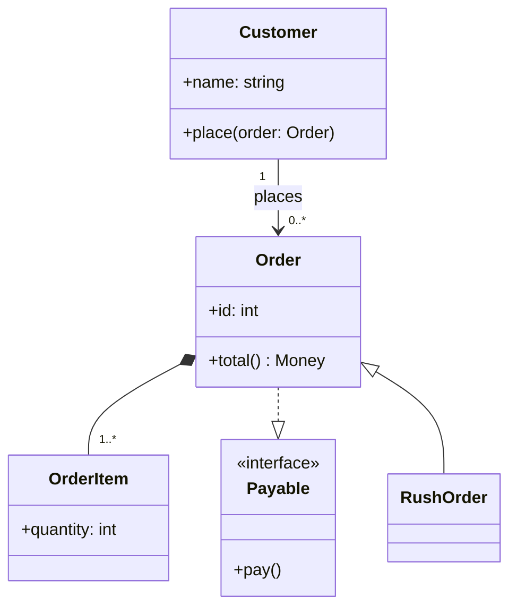

# Class diagram guide

<!-- Written by guideMarkdown in editor/reference.ts: change the guide there, not here. -->

Classes with their attributes and operations, and the relations between them.

## What it shows

A class diagram shows classes with their attributes and operations and how they relate: by generalization, association, aggregation, composition, dependency and realization. Use it for the static structure of software or of a domain. It is written in Mermaid's `classDiagram` syntax.

## Rules of the notation

- A class is a box with its name, its attributes and its operations. A member with `(` is an operation, any other an attribute.
- Generalization: a solid line with a hollow triangle at the general class. Realization: the same dashed, the triangle at the interface.
- Composition: a filled diamond at the composite, which owns the lifecycle of its parts. Shared aggregation: a hollow diamond at the aggregate.
- Association: a solid line. An open arrowhead marks the navigable end; multiplicities stand beside the ends.
- Dependency: a dashed line with an open arrowhead at the supplier.
- A class exists as soon as a statement names it. A relation needs no declaration of its ends.
- A namespace is drawn as a package. It only declares classes: a class belongs to the namespace its `class` statement stands in, and relations stand outside all namespaces.
- `%% level conceptual` is TAM's conceptual level: no visibility, interfaces, templates, realization or dependencies.
- A diagram has at most 200 classes, 60 members in a class, and 20,000 characters.

## Diagram

| You write | It means |
| --- | --- |
| `classDiagram` | The first line. `classDiagram-v2` is read the same. |
| `---` `title: Order system` `---` | The title, in a frontmatter block before the first line. |
| `%% level conceptual` | TAM's conceptual level, as a comment before or after the first line. `%% level design` allows everything, as no level does. |
| `%% a remark` | A comment: a line of its own that starts with `%%`. |
| `direction LR` | The way the layout runs: `TB` (the default), `LR`, `BT` or `RL`. `TD` is `TB`. |

## Classes

| You write | It means |
| --- | --- |
| `class Order` | A class. Its name is letters, digits, `_` and `.`. |
| `class Order["Customer order"]` | A class with a text of its own to show. |
| `` class `Order Item` `` | Backticks allow any name. |
| `class List~T~` | A template: shown as `List<T>`. |
| `class Shape <<abstract>>` | An annotation, shown as «abstract» above the name. |
| `<<interface>> Payable` | An annotation as a statement of its own. |
| `class Order {` &nbsp;&nbsp;`+id: int` &nbsp;&nbsp;`+total() Money` `}` | A class with its members, one on each line between `{` and `}`. |
| `class Order { +id: int }` | One member on the line of the class. |
| `Order : +id int` | A member added from outside the braces. |

## Members

A member is shown as it is written. These signs are read:

| You write | It means |
| --- | --- |
| `class Order {` &nbsp;&nbsp;`+id: int` &nbsp;&nbsp;`-secret: string` &nbsp;&nbsp;`#state: State` &nbsp;&nbsp;`~count: int` `}` | Visibility before the name: `+` public, `-` private, `#` protected, `~` package. |
| `class Order {` &nbsp;&nbsp;`+total() Money` &nbsp;&nbsp;`+find(id: int): Order` `}` | An operation with its result after the brackets, with or without a colon. Shown as `total() : Money`. |
| `class Order {` &nbsp;&nbsp;`+count() int$` `}` | `$` at the end: static, underlined. |
| `class Shape {` &nbsp;&nbsp;`+area() float*` `}` | `*` at the end: abstract, in italics. |
| `class Cart {` &nbsp;&nbsp;`+items: List~Item~` `}` | `~T~` in a type is shown as `<T>`. |
| `class Payable {` &nbsp;&nbsp;`<<interface>>` &nbsp;&nbsp;`+pay()` `}` | An annotation inside the braces: `<<interface>>`, `<<abstract>>`, `<<enumeration>>`, `<<service>>` or any word. |

## Relations

One relation on a line, between two class names. Every sign may stand at either end; the line is `--` (solid) or `..` (dashed).

| You write | It means |
| --- | --- |
| `Animal <\|-- Dog` | Generalization: `Dog` specializes `Animal`. The triangle is at `Animal`. |
| `Dog --\|> Animal` | The same, written from the specific class. |
| `Order *-- OrderItem` | Composition: `OrderItem` is a part of the composite `Order`. Also `OrderItem --* Order`. |
| `Team o-- Player` | Shared aggregation: `Team` aggregates `Player`. Also `Player --o Team`. |
| `Customer --> Order` | Association, navigable from `Customer` to `Order`. Also `Order <-- Customer`. |
| `Customer -- Order` | Association, navigability unspecified. |
| `Customer <--> Order` | Association, navigable in both directions. |
| `Order ..> Mailer` | Dependency: `Order` is the client, `Mailer` the supplier. Also `Mailer <.. Order`. |
| `Order ..\|> Payable` | Realization: `Order` implements `Payable`. Also `Payable <\|.. Order`. |
| `Order .. Draft` | A dashed line without ends. |
| `Customer "1" --> "0..*" Order` | Multiplicities in quotes, beside the ends. |
| `Customer --> Order : places` | The association's name, after a colon. |
| `Customer "1" --> "0..*" Order : places` | Both. |
| `IPayable ()-- Order` | `IPayable` as a provided interface of `Order`, in ball notation. |
| `Order --() IPayable` | The same, the ball written at the right. |
| `<\|   \|>   *   o   <   >   ()` | The end adornments: triangle, filled diamond, hollow diamond, open arrowhead, ball. |

## Namespaces

| You write | It means |
| --- | --- |
| `namespace shop {` &nbsp;&nbsp;`class Order` &nbsp;&nbsp;`class Cart` `}` | A package with the classes declared in it. |
| `namespace shop["Web shop"] {` &nbsp;&nbsp;`class Order` `}` | A package with a text of its own. |
| `namespace shop.core {` &nbsp;&nbsp;`class Order` `}` | A dot nests: package `core` inside package `shop`. Namespaces may also be written inside each other. |

## Notes

| You write | It means |
| --- | --- |
| `note "Prices include tax"` | A note on its own. |
| `note for Order "Created at checkout"` | A note attached to a class. |
| `note for Order "First line\nsecond line"` | `\n` or ` ` breaks a line. `#quot;` writes a quote. |

## Read and not drawn

| You write | It means |
| --- | --- |
| `Order:::important` | A style class on a class: alone, or in its `class` line. |
| `classDef important fill:#f96` | Styles: `classDef`, `style`, `cssClass`. |
| `click Order href "https://example.com"` | Links: `click`, `link`, `callback`. |
| `accTitle: Orders` | Texts for screen readers: `accTitle`, `accDescr`. |

## Positions

Without positions the diagram lays itself out. Moving a part in the editor writes a position for every part, as comment lines at the end of the source, so the source stays valid Mermaid. A class is placed by its name.

| You write | It means |
| --- | --- |
| `%% @Order 120,40` | The part with this id stands with its top left corner at x 120, y 40, in pixels, y down. A part without such a line stays where the layout puts it; without any such line the layout is automatic again. |
| `%% @label:r1 +20,-14` | The label of the connection `r1`, the first in the source (`r2` the second, and so on), stands with its middle 20 right of and 14 above the middle of its line, which it keeps to when the line moves. Dragging a label in the editor writes it. |

## Example

## Not supported

| Not accepted | Why, and what to write |
| --- | --- |
| `title Orders` | Mermaid's `title` statement. Write the title in frontmatter. |
| `Order` | A name alone declares nothing. Write `class Order`. |
| `A -- B -- C` | One relation on a line. |
| `namespace shop {` &nbsp;&nbsp;`class A` &nbsp;&nbsp;`A --> B` `}` | Relations stand outside namespaces. |
| `class Order {` &nbsp;&nbsp;`+id: int` | A class body ends with `}`. |
| `class Payable {` &nbsp;&nbsp;`<<interface>>` `}` | At the conceptual level: no interfaces, visibility, templates, realization or dependencies. |
