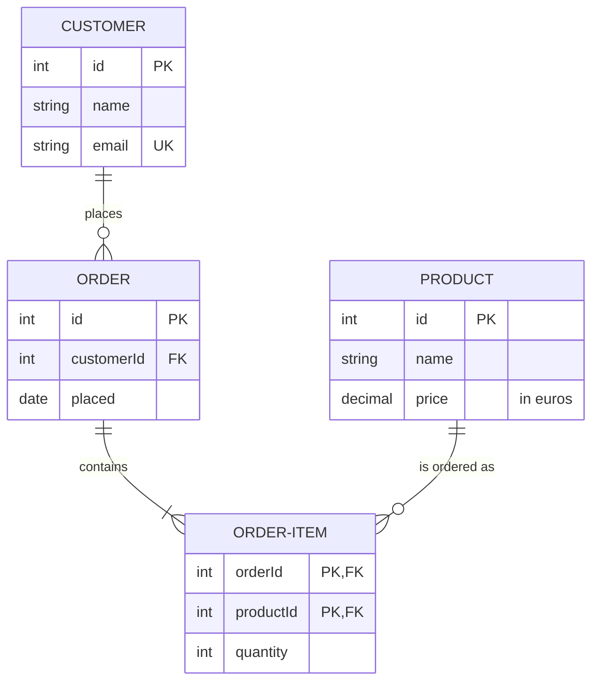

# Entity relationship diagram guide

<!-- Written by guideMarkdown in editor/reference.ts: change the guide there, not here. -->

Entity types with their attributes and keys, and the cardinalities of their relationships.

## What it shows

An entity relationship diagram shows the entity types of a data model, their attributes and keys, and the relationships between them with their cardinalities. Use it for a conceptual or logical data model, or the tables of a database schema. It is written in Mermaid's `erDiagram` syntax and drawn in crow's foot notation.

## Rules of the notation

- An entity type is a box with its name above one row for each attribute: type, name, keys and comment.
- A relationship is a line between two entity types. The symbol at each end is the cardinality of that end per instance of the other: a bar is one, a ring is zero, a crow's foot is many.
- `CUSTOMER ||--o{ ORDER` reads from both ends: an order relates to exactly one customer, a customer to zero or more orders.
- A solid line is an identifying relationship: the second entity type is existence-dependent on the first and identified through it. A dashed line is a non-identifying one.
- An entity type exists as soon as a statement names it. Several blocks of one entity type add up their attributes. A relationship may be recursive.
- An attribute belongs to the keys named after it: `PK` primary, `FK` foreign, `UK` unique. A primary key attribute is underlined.
- A name starts with a letter or `_` and goes on with letters, digits, `_` and `-`; any other name stands in quotes.
- A diagram has at most 200 entities, 60 attributes in an entity, and 20,000 characters.

## Diagram

| You write | It means |
| --- | --- |
| `erDiagram` | The first line. Nothing follows it on the line. |
| `---` `title: Order system` `---` | The title, in a frontmatter block before the first line. |
| `%% a remark` | A comment: a line of its own that starts with `%%`. |
| `title Order model` | The title as a statement. A title in frontmatter comes first. |
| `direction LR` | The way the layout runs: `TB` (the default), `LR`, `BT` or `RL`. `TD` is `TB`. |

## Entities

| You write | It means |
| --- | --- |
| `CUSTOMER` | An entity type without attributes. |
| `CUSTOMER["Retail customer"]` | An entity type with a display name. The quotes are optional. |
| `ORDER-ITEM` | A name may have hyphens. |
| `"Order item"` | Quotes allow any name. |
| `CUSTOMER {` &nbsp;&nbsp;`int id PK` &nbsp;&nbsp;`string name` `}` | An entity type with its attributes, one on each line between `{` and `}`. |
| `CUSTOMER { int id PK }` | A block on one line. |

## Attributes

An attribute is a type and a name, then its keys, then a comment. Both type and name are single words.

| You write | It means |
| --- | --- |
| `ORDER {` &nbsp;&nbsp;`date placed` `}` | A type and a name. The type is any word: `int`, `string`, `varchar(20)`, `date[]`. |
| `ORDER {` &nbsp;&nbsp;`int id PK` `}` | A key: `PK` primary, `FK` foreign or `UK` unique. |
| `ORDER-ITEM {` &nbsp;&nbsp;`int orderId PK, FK` `}` | Several keys, with commas between. |
| `ORDER {` &nbsp;&nbsp;`string status "open, paid or sent"` `}` | A comment in quotes, at the end. |
| `ORDER {` &nbsp;&nbsp;`int customerId FK "who placed it"` `}` | Keys and a comment. |
| `ORDER {` &nbsp;&nbsp;`list~string~ tags` `}` | `~T~` in a type is shown as `<T>`. |

## Relationships

Two entity types with a line between, a cardinality at each end of the line, then a colon and a label. Spaces around the symbols are optional, and so are the colon and the label.

| You write | It means |
| --- | --- |
| `CUSTOMER \|\|--o{ ORDER : places` | One customer, zero or more orders. |
| `ORDER \|\|--\|{ ORDER-ITEM : contains` | One order, one or more items. |
| `PERSON \|\|--o\| PASSPORT : holds` | One person, zero or one passport. |
| `PERSON \|\|--\|\| BIRTH : has` | One to exactly one. |
| `STUDENT }o--o{ COURSE : attends` | Zero or more on both sides. |
| `ORDER }o--\|\| CUSTOMER : belongs to` | Written from the many end. |
| `CUSTOMER \|\|..o{ ADDRESS : uses` | A dashed line: a non-identifying relationship. `.-` and `-.` are read the same. |
| `EMPLOYEE \|o--o{ EMPLOYEE : manages` | A recursive relationship. |
| `CUSTOMER \|\|--o{ ORDER : "places: online"` | The label may stand in quotes. |
| `CUSTOMER \|\|--o{ ORDER` | Without a label. |
| `CUSTOMER \|\|--o{ ORDER : ""` | Empty quotes say the same where Mermaid asks for a label. |
| `\|\|` | Exactly one: two bars. |
| `\|o   o\|` | Zero or one: a ring and a bar. `\|o` stands left of the line, `o\|` right of it. |
| `}\|   \|{` | One or more: a bar and a crow's foot. |
| `}o   o{` | Zero or more: a ring and a crow's foot. |
| `--   ..` | The line: identifying and non-identifying relationship. |

## Relationships in words

| You write | It means |
| --- | --- |
| `CUSTOMER only one to zero or more ORDER : places` | The same as `\|\|--o{`: cardinalities in words, and `to` for the solid line. |
| `CUSTOMER one optionally to many ADDRESS : uses` | `optionally to` is the dashed line. |
| `only one   one   1` | Exactly one. |
| `zero or one   one or zero` | Zero or one. |
| `one or more   one or many   many(1)   1+` | One or more. |
| `zero or more   zero or many   many(0)   many   0+` | Zero or more. |

## Read and not drawn

| You write | It means |
| --- | --- |
| `CUSTOMER:::important` | A style class on an entity. |
| `classDef important fill:#f96` | Styles: `classDef`, `class`, `style`, `linkStyle`. |
| `click CUSTOMER href "https://example.com"` | Links: `click`, `link`, `callback`. |
| `accTitle: Orders` | Texts for screen readers: `accTitle`, `accDescr`. |

## Positions

Without positions the diagram lays itself out. Moving a part in the editor writes a position for every part, as comment lines at the end of the source, so the source stays valid Mermaid. An entity is placed by its name.

| You write | It means |
| --- | --- |
| `%% @CUSTOMER 120,40` | The part with this id stands with its top left corner at x 120, y 40, in pixels, y down. A part without such a line stays where the layout puts it; without any such line the layout is automatic again. |

## Example

## Not supported

| Not accepted | Why, and what to write |
| --- | --- |
| `CUSTOMER --> ORDER` | A relationship has a cardinality at each end: `CUSTOMER \|\|--o{ ORDER`. |
| `CUSTOMER \|\|--o{ ORDER :` | A colon is followed by a label. |
| `CUSTOMER u--o{ ORDER : x` | Mermaid's `u` end. |
| `erDiagram LR` | Nothing follows `erDiagram`. Write `direction LR` on a line of its own. |
| `ORDER {` &nbsp;&nbsp;`int id PK FK` `}` | Several keys take commas: `PK, FK`. |
| `ORDER {` &nbsp;&nbsp;`int` `}` | An attribute has a type and a name. |
| `ORDER {` &nbsp;&nbsp;`date placed on` `}` | A name is one word; what follows is a key or a comment in quotes. |
| `ORDER {` &nbsp;&nbsp;`int id` | A block ends with `}`. |
