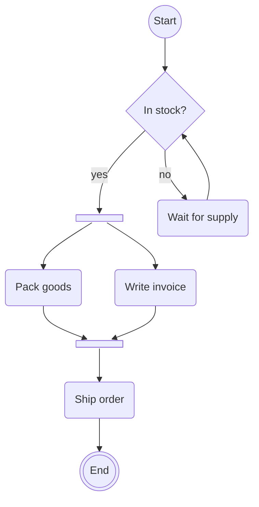

# Activity diagram guide

<!-- Written by guideMarkdown in src/guide-text.ts from src/reference.ts: change the guide there, not here. -->

Actions and control flow: decision, merge, fork, join, initial and final nodes, and lanes for the agents responsible.

## What it shows

An activity diagram shows the control flow between actions: their order, decision and merge nodes, concurrency through fork and join nodes, and initial and final nodes. Use it for a business process or an algorithm. It is written in Mermaid's `flowchart` syntax and drawn as a UML activity diagram. Lanes are optional: in a diagram with lanes every lane is an activity partition that holds the actions of one agent, for a process that spans human agents, organizational units or systems. Such a diagram starts with `swimlane-beta` instead, and its subgraphs are its lanes.

## Rules of the notation

- An action is an executable node of the activity. A control flow is an arrow from one node to the next.
- A decision node is a diamond with one incoming flow and several outgoing ones. The text of an outgoing flow is its guard, shown in square brackets. A merge node is a diamond that joins alternative flows; a diamond that does both is drawn as a merge node followed by a decision node.
- The initial node is a filled dot: a circle `((…))` that flows only leave. The final node is a ringed dot: a double circle `(((…)))` that flows only enter. A circle that flows enter stays a circle; a double circle that flows leave stays one.
- A fork node splits one flow into concurrent flows, a join node synchronizes them: `@{ shape: fork }`.
- A flow final node, a crossed circle, ends one flow while the others continue.
- Decisions, merges, initial and final nodes have no flow to themselves.
- A node exists as soon as a statement names it. Its shape and text may be given at any mention; the last one given counts.
- A node stands in the subgraph where it is named first inside one.
- Lanes and groups do not mix: under `flowchart` every subgraph is a group, under `swimlane-beta` every subgraph is a lane.
- `end`, `subgraph`, `graph`, `flowchart`, `direction`, `style`, `linkStyle`, `classDef`, `class` and `click` are keywords, not ids.
- A diagram has at most 300 nodes, 500 flows and 20,000 characters.

## Diagram

| You write | It means |
| --- | --- |
| `flowchart TB` | The first line, with the way the flow runs: `TB` (top to bottom, the default) or `LR` (left to right). `TD` is `TB`; `>` and `v` point the way too. |
| `graph LR` | `graph` and `flowchart-elk` are read as `flowchart`. |
| `---` `title: Order system` `---` | The title, in a frontmatter block before the first line. |
| `%% level conceptual` | TAM's level, as a comment before or after the first line. An activity diagram may be of either level. |
| `%% a remark` | A comment: a line of its own that starts with `%%`. |

## Nodes

| You write | It means |
| --- | --- |
| `pack(Pack goods)` | An action: an id, and its text in round brackets. A rounded box. |
| `pack[Pack goods]` | Square brackets are an action too, drawn the same. |
| `ok{In stock?}` | A decision or merge node: a diamond. Its text stands beside it. |
| `start((Start))` | A circle. With flows that only leave it, it is the initial node: a filled dot. |
| `done(((End)))` | A double circle. With flows that only enter it, it is the final node. |
| `pack` | An id alone: an action that shows its id. Flows may name nodes that are declared nowhere. |
| `pack("Pack (all) goods")` | Quotes keep brackets and signs inside a text. |
| ``pack("`Pack **all** goods`")`` | A Markdown text: shown without its emphasis signs. |
| `pack(Pack goods)` | ` ` breaks a line. `#quot;` writes a quote, `#35;` the character with that number. Angle brackets show as written, as in `autofix/<id>`, except HTML formatting tags such as `<b>`: they format the text, and `#lt;b>` shows one. |
| `db[(Orders)]` | A cylinder: an object node, a data store. |
| `pill([Wait])` | Mermaid's stadium: drawn as an action. |
| `sub[[Check credit]]` | A subroutine: a rectangle with double sides. |
| `prep{{Prepare}}` | A hexagon. |
| `in[/Read order/]` | A parallelogram leaning right: input or output. |
| `out[\Print slip\]` | Leaning left. |
| `manual[/Check by hand\]` | A trapezoid, wide at the bottom. |
| `prio[\Sort/]` | A trapezoid, wide at the top. |
| `flag>Order received]` | A flag. |
| `split@{ shape: fork }` | A fork or join bar. `join` is the same shape. |
| `first@{ shape: start }` | The initial node, whatever flows it has. |
| `last@{ shape: stop }` | The final node. |
| `abort@{ shape: cross-circ }` | A flow final node: a crossed circle. It ends its flow, not the activity. |
| `ok@{ shape: diamond, label: "In stock?" }` | Any shape by its Mermaid name, with its text: `rect`, `rounded`, `stadium`, `subroutine`, `cyl`, `circle`, `dbl-circ`, `diamond`, `hex`, `lean-r`, `lean-l`, `trap-b`, `trap-t`, `odd`, and Mermaid's longer names for them. |

## Flows

A flow may be written with or without spaces around its arrow.

| You write | It means |
| --- | --- |
| `a --> b` | A control flow from `a` to `b`. |
| `a -->\|yes\| b` | A flow with a text between bars: the guard of a flow leaving a decision node. |
| `a -- yes --> b` | The same, the text inside the arrow. |
| `a --- b` | A line without an arrow. With a text: `a ---\|text\| b` or `a -- text --- b`. |
| `a -.-> b` | A dotted flow. With a text: `a -. text .-> b`. Without an arrow: `a -.- b`. |
| `a ==> b` | A thick flow. With a text: `a == text ==> b`. Without an arrow: `a === b`. |
| `a <--> b` | Arrows at both ends. Also `<-.->` and `<==>`. |
| `a --o b` | A circle at the end. Both ends: `a o--o b`. |
| `a --x b` | A cross at the end. Both ends: `a x--x b`. |
| `a ~~~ b` | An invisible link: it only keeps `a` before `b` in the layout. |
| `a ----> b` | More dashes are read as the same flow. |
| `a --> b --> c` | A chain: each arrow is a flow of its own. |
| `a & b --> c & d` | `&` lists several ends: every one on the left to every one on the right. |
| `a(Pack) --> b{Ok?}` | Nodes may get their shape and text where a flow names them. |
| `a e1@--> b` | An id for the flow before its arrow is read and ignored. |
| `a --> b; b --> c` | `;` separates statements on one line. |

## Groups

| You write | It means |
| --- | --- |
| `subgraph packing [Packing]` &nbsp;&nbsp;`box(Box it) --> label(Label it)` `end` | A group of activity nodes in a frame: an id, and its title in square brackets. |
| `subgraph Packing` &nbsp;&nbsp;`box(Box it)` `end` | An id alone is the title. |
| `subgraph "Packing station"` &nbsp;&nbsp;`box(Box it)` `end` | A title in quotes, without an id. |
| `subgraph` &nbsp;&nbsp;`box(Box it)` `end` | A frame without a title. |
| `subgraph outer` &nbsp;&nbsp;`subgraph inner` &nbsp;&nbsp;&nbsp;&nbsp;`box(Box it)` &nbsp;&nbsp;`end` `end` `start --> outer` | Subgraphs nest, and a flow may end at a subgraph's id. |

## Lanes

- A diagram with lanes starts with `swimlane-beta` instead of `flowchart`, and every `subgraph` of it is a lane: an activity partition named after the agent responsible for its actions. Lanes stand side by side in the order of the source.
- A node stands in the lane where it is named first inside one. Nodes named in no lane share a lane without a name.
- Flows run from node to node, also across lanes. A flow does not end at a lane, and lanes do not nest.
- Lanes and groups do not mix: a diagram with lanes has no groups. A placed node stays in its lane.

| You write | It means |
| --- | --- |
| `swimlane-beta TB` | The first line of a diagram with lanes, with the way the flow runs. `TB` (the default): lanes are columns. `LR`: lanes are rows. `TD` is `TB`; `>` and `v` point the way too. |
| `subgraph Customer` &nbsp;&nbsp;`order(Place order)` `end` | A lane with its nodes, between its line and `end`. The id is its title. |
| `subgraph shop [Web Shop]` &nbsp;&nbsp;`check(Check order)` `end` | An id, and the title in square brackets. |
| `subgraph "Web Shop"` &nbsp;&nbsp;`check(Check order)` `end` | A title in quotes, without an id. |
| `subgraph Customer` &nbsp;&nbsp;`order(Place order)` `end` `subgraph Shop` &nbsp;&nbsp;`check(Check order)` `end` `order --> check` | A flow from lane to lane. It may stand after the lanes or inside one. |

## Read and not drawn

| You write | It means |
| --- | --- |
| `a:::important --> b` | A style class on a node. |
| `classDef important fill:#f96` | Styles: `classDef`, `class`, `style`, `linkStyle`. |
| `click a "https://example.com"` | Links: `click`, `callback`. |
| `direction LR` | A `direction` line: the first line says the direction. |
| `accTitle: Shipping` | Texts for screen readers: `accTitle`, `accDescr`. |

## Positions

Without positions the diagram lays itself out. Moving a part in the editor writes a position for every part, as comment lines at the end of the source, so the source stays valid Mermaid. A node is placed by its id.

| You write | It means |
| --- | --- |
| `%% @pack 120,40` | The part with this id stands with its top left corner at x 120, y 40, in pixels, y down. A part without such a line stays where the layout puts it; without any such line the layout is automatic again. |
| `%% @label:e1 +20,-14` | The label of the connection `e1`, the first in the source (`e2` the second, and so on), stands with its middle 20 right of and 14 above the middle of its line, which it keeps to when the line moves. Dragging a label in the editor writes it. |
| `%% @lane:Customer 260` | In a diagram with lanes, the lane of the subgraph `Customer` is 260 wide across the lanes (high, in `LR`), never less than its nodes, its name and its labels need. Dragging the border after a lane in the editor writes it; the outer edge is the last lane's. |

## Example

## Not supported

| Not accepted | Why, and what to write |
| --- | --- |
| `ok{In stock?} --> ok` | A flow from a decision, merge, initial or final node to itself. |
| `c@{ shape: cloud }` | Mermaid's other shapes: only the ones under Nodes are drawn. |
| `c@{ icon: "fa:user" }` | Icon and image nodes. |
| `end --> b` | `end` is a keyword. Name the node otherwise, or give it a text: `stop[end]`. |
| `a --> b %% the usual way` | A comment is a line of its own. |
| `title Shipping` | Write the title in frontmatter. |
| `subgraph packing` &nbsp;&nbsp;`box(Box it)` | A subgraph ends with `end`. |
| `order --> Shop` | A flow to a lane. Name a node in it. |
| `subgraph Store` &nbsp;&nbsp;`subgraph Desk` &nbsp;&nbsp;&nbsp;&nbsp;`serve(Serve)` &nbsp;&nbsp;`end` `end` | A subgraph inside a lane: lanes do not nest, and a diagram with lanes has no groups. |
