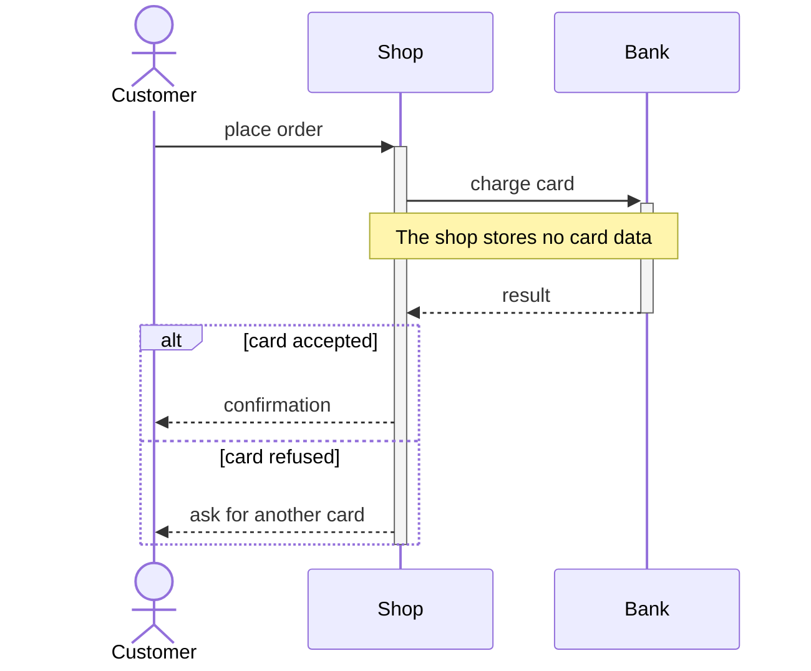

# Sequence diagram guide

<!-- Written by guideMarkdown in editor/reference.ts: change the guide there, not here. -->

Messages between the lifelines of agents, ordered in time.

## What it shows

A sequence diagram shows an interaction: the messages exchanged between agents, ordered in time. Every participant is a lifeline that runs down, every message an arrow between two lifelines. Use it for one scenario of an interaction. It is written in Mermaid's `sequenceDiagram` syntax.

## Rules of the notation

- A participant is a box above its lifeline, an actor a stick figure. Participants stand from left to right in the order the source names them; declare them first to choose the order.
- A solid arrow with a filled head is a synchronous message: the sender blocks until the reply. A dashed arrow with an open head is the reply message. A solid arrow with an open head is an asynchronous message: the sender does not block.
- An activation bar on a lifeline is an execution specification: the participant is executing a behavior. A bar is white while its participant awaits a reply.
- `+` on an arrow activates the receiver, `-` ends the activation of the sender. A participant that is not active cannot be deactivated.
- A combined fragment frames messages under an interaction operator: `loop`, `alt`, `opt`, `par`, `critical`, `break`. `else` separates the operands of `alt`, `and` those of `par`, `option` those of `critical`. Fragments nest, and each ends with `end`.
- A note stands left of, right of or over one participant, or over two.
- A box frames a group of participants. Boxes do not nest.
- Creating and destroying participants belongs to TAM's design level: `%% level conceptual` refuses it.
- A diagram has at most 40 participants and 20,000 characters.

## Diagram

| You write | It means |
| --- | --- |
| `sequenceDiagram` | The first line. |
| `title Checkout` | The title. `title: Checkout` is read the same. |
| `---` `title: Order system` `---` | The title, in a frontmatter block before the first line. |
| `%% level conceptual` | TAM's conceptual level, as a comment before or after the first line. |
| `%% a remark` | A comment: a line of its own that starts with `%%`. |
| `autonumber` | Numbers the messages that follow, from 1. |
| `autonumber 10 5` | From 10, in steps of 5. `autonumber off` stops the numbering. |

## Participants

| You write | It means |
| --- | --- |
| `participant Shop` | A participant: a head box above its lifeline. Its id is its name. |
| `participant S as Shop server` | An id, and the name to show. |
| `actor Customer` | An actor, a human agent: a stick figure. |
| `actor C as Retail customer` | An actor with an id and a name. |
| `participant Web Shop` | An id may have spaces. |
| `box Backend` &nbsp;&nbsp;`participant Shop` &nbsp;&nbsp;`participant Bank` `end` | A box around participants, with its title. A color before the title, as in `box blue Backend`, is ignored. |

## Messages

A message is two participants with an arrow between, then a colon and the text. Spaces around the arrow are optional, and so is the text. A participant a message names needs no declaration.

| You write | It means |
| --- | --- |
| `A->>B: place order` | A synchronous message: solid, filled head. |
| `B-->>A: confirmation` | A reply message: dashed, open head. |
| `A-)B: notify` | An asynchronous message: solid, open head. |
| `B--)A: notify back` | Dashed, open head. |
| `A-xB: lost` | A lost message: a cross at its end. Dashed: `--x`. |
| `A->B: hint` | A solid line without a head. Dashed: `-->`. |
| `A<<->>B: sync` | Heads at both ends. Dashed: `<<-->>`. |
| `A->>A: think` | A self message. |
| `A->>B: first line second line` | ` ` breaks a line. `#quot;` writes a quote, `#35;` the character with that number. |

## Activation

| You write | It means |
| --- | --- |
| `A->>+B: place order` `B-->>-A: confirmation` | `+` after the arrow starts an execution specification on the receiver; `-` ends the sender's. |
| `A->>B: place order` `activate B` `B-->>A: confirmation` `deactivate B` | The same as statements of their own. |
| `A->>+B: first` `A->>+B: second` `B-->>-A: second done` `B-->>-A: first done` | Activations nest: each `+` opens a bar on the one before. |

## Fragments

| You write | It means |
| --- | --- |
| `loop every hour` &nbsp;&nbsp;`A->>B: poll` `end` | `loop`: the operand repeats while its guard holds. |
| `alt in stock` &nbsp;&nbsp;`B-->>A: confirmed` `else sold out` &nbsp;&nbsp;`B-->>A: refused` `end` | `alt`: the operand whose guard holds is executed. More `else` lines add operands. |
| `opt has a voucher` &nbsp;&nbsp;`A->>B: redeem` `end` | `opt`: the single operand is executed only if its guard holds. |
| `par notify` &nbsp;&nbsp;`B-)A: mail` `and book` &nbsp;&nbsp;`B->>B: write ledger` `end` | `par`: the operands execute concurrently. |
| `critical reserve stock` &nbsp;&nbsp;`A->>B: reserve` `option timeout` &nbsp;&nbsp;`A->>B: cancel` `end` | `critical`: an atomic region; `option` adds the operand for its failure. |
| `break out of stock` &nbsp;&nbsp;`B-->>A: refused` `end` | `break`: the operand is executed instead of the rest of the enclosing interaction. |
| `rect rgb(240, 240, 240)` &nbsp;&nbsp;`A->>B: place order` `end` | A frame without a keyword around messages. The color is ignored. |

## Notes

| You write | It means |
| --- | --- |
| `note over A: Checks the cart` | A note over a lifeline. |
| `note over A,B: Both are online` | A note over two lifelines. |
| `note left of A: Starts here` | A note beside a lifeline: `left of` or `right of`. |

## Creating and destroying: design level

| You write | It means |
| --- | --- |
| `create participant C` `B->>C: new` | The lifeline of `C` starts with the next message to it, its creation message, not at the top. |
| `create actor C` `B->>C: welcome` | The same for an actor. |
| `destroy B` `A-xB: close` | The lifeline of `B` ends with a destruction occurrence at the next message to or from it. |

## Read and not drawn

| You write | It means |
| --- | --- |
| `link A: Dashboard @ https://example.com` | Menus of a participant: `link`, `links`, `properties`, `details`. |
| `accTitle: Checkout` | Texts for screen readers: `accTitle`, `accDescr`. |

## Positions

Without positions the diagram lays itself out. Moving a part in the editor writes a position for every part, as comment lines at the end of the source, so the source stays valid Mermaid. Only participants are placed, by `head:` and their id, and only along their row: messages keep their order.

| You write | It means |
| --- | --- |
| `%% @head:A 120,40` | The part with this id stands with its top left corner at x 120, y 40, in pixels, y down. A part without such a line stays where the layout puts it; without any such line the layout is automatic again. |
| `%% @label:m1 +20,-14` | The label of the connection `m1`, the first in the source (`m2` the second, and so on), stands with its middle 20 right of and 14 above the middle of its line, which it keeps to when the line moves. Dragging a label in the editor writes it. |

## Example

## Not supported

| Not accepted | Why, and what to write |
| --- | --- |
| `participant D@{ "type": "database" }` | Mermaid's participant types. |
| `par_over one` &nbsp;&nbsp;`A->>B: x` `end` | Mermaid's `par_over`. |
| `A-\|\B: half` | Mermaid's half arrows. |
| `direction LR` | Lifelines always run down. |
| `A->>B: place order` `deactivate B` | `B` is not active: nothing activated it. |
| `else sold out` &nbsp;&nbsp;`A->>B: x` | `else` stands inside `alt`. |
| `note left of A,B: both` | Only `over` spans two participants, and none spans more. |
| `box One` &nbsp;&nbsp;`box Two` &nbsp;&nbsp;`end` `end` | Boxes do not nest. |
| `loop every hour` &nbsp;&nbsp;`A->>B: poll` | A fragment ends with `end`. |
| `create participant C` `B->>C: new` | TAM's conceptual level has no creation and destruction. |
