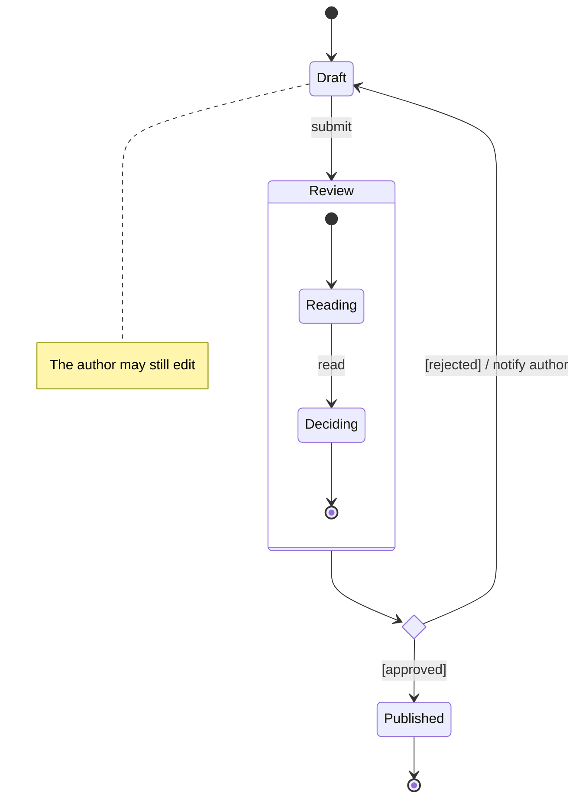

# State machine diagram guide

<!-- Written by guideMarkdown in src/guide-text.ts from src/reference.ts: change the guide there, not here. -->

The states of one object and the transitions between them.

## What it shows

A state machine diagram shows the states of one object and the transitions between them, each triggered by an event and guarded by a condition. Use it for the lifecycle of an object, a document or a connection. It is written in Mermaid's `stateDiagram-v2` syntax.

## Rules of the notation

- A state is a rounded box. A transition is an arrow, labelled `event [guard] / effect`: the trigger, the guard condition, and the effect behavior. Every part is optional.
- `[*]` before an arrow is the initial pseudostate of its region, a filled dot: every such line starts at the same dot. `[*]` after an arrow is a final state, a ringed dot: every such line draws one of its own.
- A composite state contains substates and has its own initial pseudostate and final states. It shows a name only, no description.
- Inside a composite state `--` separates orthogonal regions, active concurrently.
- A choice pseudostate is a diamond: the guards of its outgoing transitions select one. It has no transition to itself.
- A fork pseudostate splits one transition into concurrent ones, a join pseudostate synchronizes them.
- A state exists as soon as a statement names it, and stands in the composite state where it is named first. Its id has no spaces and none of `:`, `-`, `{`, `}`, `"`.
- TAM puts state machines at the conceptual level: `%% level design` is refused, and `%% level conceptual` refuses fork and join bars.
- A diagram has at most 300 states and 20,000 characters.

## Diagram

| You write | It means |
| --- | --- |
| `stateDiagram-v2` | The first line. `stateDiagram` is read the same. |
| `---` `title: Order system` `---` | The title, in a frontmatter block before the first line. |
| `%% a remark` | A comment: a line of its own that starts with `%%`. |
| `direction LR` | The way the layout runs: `TB` (the default) or `LR`. `TD` is `TB`. Inside a composite state the line is ignored. |

## States

| You write | It means |
| --- | --- |
| `Idle` | A state: its id is its name. |
| `state Idle` | The same with the keyword. |
| `state "Waiting for input" as Waiting` | A state with a name of several words, and its id. |
| `Idle : entry / reset` | A description below the name, such as internal behavior. Each such line adds one. |

## Transitions

| You write | It means |
| --- | --- |
| `Idle --> Busy` | A transition from `Idle` to `Busy`. |
| `Idle --> Busy : start` | The trigger event, after a colon. |
| `Idle --> Busy : start [ready] / beep` | Trigger, guard and effect. ` ` breaks a line. `#quot;` writes a quote, `#35;` the character with that number. Angle brackets show as written, as in `autofix/<id>`, except HTML formatting tags such as `<b>`: they format the text, and `#lt;b>` shows one. |
| `[*] --> Idle` | From the initial pseudostate to the default state. |
| `Busy --> [*]` | To a final state: the region completes. |
| `Busy --> Busy : retry` | A self-transition. |

## Choice, fork and join

| You write | It means |
| --- | --- |
| `state check <<choice>>` `Idle --> check` `check --> Busy : [ready]` `check --> Failed : [else]` | A choice pseudostate: a diamond whose outgoing guards select the transition. |
| `state split <<fork>>` `Idle --> split` `split --> Printing` `split --> Mailing` | A fork pseudostate: one transition splits into concurrent ones. |
| `state merge <<join>>` `Printing --> merge` `Mailing --> merge` `merge --> Done` | A join pseudostate: concurrent transitions synchronize into one. |
| `state check [[choice]]` | Double square brackets are read like `<< >>`. |

## Composite states and regions

| You write | It means |
| --- | --- |
| `state Active {` &nbsp;&nbsp;`[*] --> Reading` &nbsp;&nbsp;`Reading --> Writing : edit` &nbsp;&nbsp;`Writing --> [*]` `}` | A composite state: its substates and transitions stand between `{` and `}`. The `}` is a line of its own. |
| `state "In work" as Active {` &nbsp;&nbsp;`Reading --> Writing` `}` | A composite state with a name of several words. |
| `state Active {` &nbsp;&nbsp;`Reading --> Writing` &nbsp;&nbsp;`--` &nbsp;&nbsp;`Online --> Offline` `}` | `--` on a line of its own starts another orthogonal region. |
| `state Active {` &nbsp;&nbsp;`state Editing {` &nbsp;&nbsp;&nbsp;&nbsp;`Typing --> Saving` &nbsp;&nbsp;`}` `}` `Active --> Closed : close` `Saving --> Closed : quit` | Composite states nest, and transitions go to and from a composite state or its substates. |

## Notes

| You write | It means |
| --- | --- |
| `note right of Idle : Waits for a job` | A note beside a state: `right of` or `left of`. |
| `note left of Idle` &nbsp;&nbsp;`Waits for a job.` &nbsp;&nbsp;`Uses no power.` `end note` | A note of several lines, up to `end note`. |

## Read and not drawn

| You write | It means |
| --- | --- |
| `Idle:::important --> Busy` | A style class on a state. |
| `classDef important fill:#f96` | Styles: `classDef`, `class`, `style`. |
| `hide empty description` | Mermaid's display options: this one and `scale 350 width`. |
| `accTitle: Printer` | Texts for screen readers: `accTitle`, `accDescr`. |

## Positions

Without positions the diagram lays itself out. Moving a part in the editor writes a position for every part, as comment lines at the end of the source, so the source stays valid Mermaid. A state is placed by its id; initial and final states have ids the editor writes.

| You write | It means |
| --- | --- |
| `%% @Idle 120,40` | The part with this id stands with its top left corner at x 120, y 40, in pixels, y down. A part without such a line stays where the layout puts it; without any such line the layout is automatic again. |
| `%% @label:t1 +20,-14` | The label of the connection `t1`, the first in the source (`t2` the second, and so on), stands with its middle 20 right of and 14 above the middle of its line, which it keeps to when the line moves. Dragging a label in the editor writes it. |

## Example

## Not supported

| Not accepted | Why, and what to write |
| --- | --- |
| `Idle -> Busy` | A transition is written `-->`. |
| `state check <<choice>>` `check --> check` | A transition from a choice to itself. |
| `Idle --> Busy` `--` `On --> Off` | Regions stand inside a composite state. |
| `state Active {` &nbsp;&nbsp;`Reading` `}` `Active : busy` | A composite state has a name only, no description. |
| `state "Check" as check <<choice>>` | A choice, fork or join has an id only. |
| `state Active {}` | The braces of a composite state stand on lines of their own. |
| `state Active {` &nbsp;&nbsp;`Reading` | A composite state ends with `}`. |
| `note over Idle : text` | A note stands `left of` or `right of` a state. |
| `state Up-To-Date` | An id has no `-`. Write `state "Up-To-Date" as UpToDate`. |
| `Idle --> Busy %% next` | A comment is a line of its own. |
| `title Printer` | Write the title in frontmatter. |
| `state split <<fork>>` | TAM's conceptual level has no fork and join bars. |
